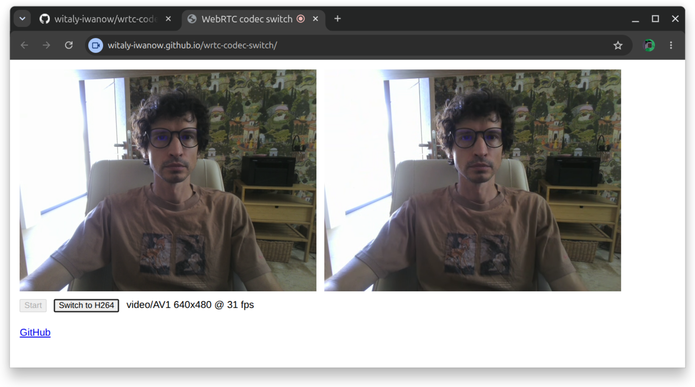

# wrtc-codec-switch

Minimal loopback WebRTC page (two `RTCPeerConnection`s in one tab, like the [pc1 sample](https://webrtc.github.io/samples/src/content/peerconnection/pc1/)) that switches the sent video codec between H264 and AV1 on the fly. Live: [witaly-iwanow.github.io/wrtc-codec-switch](https://witaly-iwanow.github.io/wrtc-codec-switch/).

Both codecs are negotiated once, up front, via `setCodecPreferences()`. The toggle then picks one of them per encoding with `RTCRtpSender.setParameters()`, setting `encodings[0].codec` to an entry from `getParameters().codecs`. No offer/answer round trip, the encoder just restarts with the other codec. Works in current Chrome and Firefox; in a browser without per-encoding codec support `setParameters()` throws, and the page alerts and falls back to reordering codec preferences and renegotiating. The status line reads the decoded codec from the receiver's `getStats()`, so it shows what actually arrives, not what was requested. SDPs, ICE candidates and state changes go to the console.

To run locally (camera access needs localhost or https):

    python3 -m http.server 8000

and open `http://localhost:8000`.
